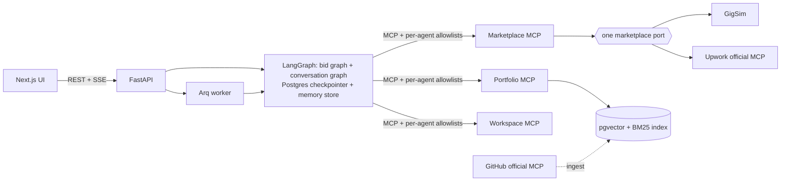

# GigBid: a multi-agent freelancer copilot

**Find good freelance jobs, skip the scams, and send proposals you can actually prove. You approve
everything.**


**Live app:** `https://<DOMAIN>`. A reviewer login is shared privately.
**Demo video (3 min):** `<link>` · **Technical write-up:** `<link>` · **Portfolio MCP on PyPI:** `uvx gigbid-portfolio-mcp`

GigBid is a team of LangGraph agents that:
1. **Scout** saved searches on a schedule and de-duplicate new jobs.
2. **Analyse** every job with three agents in parallel:
   - a *Job Analyst* (typed `JobSpec`);
   - a *Risk Assessor* (scams, off-platform requests, prompt injection);
   - a *Fit Matcher* (each requirement mapped to portfolio evidence).
3. **Decide** skip, watch or bid, and **price** the bid from market statistics, client spend, your
   floor and whether the Connects are worth it.
4. **Write** a proposal where every claim cites `[evidence_id]`. A **claim verifier** removes or
   rewrites unsupported claims, a **Critic** sends weak drafts back (at most twice), and a
   **Compliance Guard** enforces platform rules.
5. **Stop** for human approval (`interrupt()`). You approve, edit or reject in the web UI, with a
   dry-run preview of exactly what will be sent and what it costs. Then it submits **exactly once**,
   even across crashes.
6. **Handle client replies:** intent classification, drafted replies, interview slots from your
   calendar. You approve before anything is sent.
7. **Learn** from your edits and from outcomes, only through explicit promotion rules you can see
   and delete.

It runs against **GigSim**, our marketplace simulator (built for this project, with seeded clients
that have hidden preferences), and against **live Upwork** through Upwork's official MCP server
(OAuth 2.1, drafts only), using the same code path.

## Architecture

See [docs/ARCHITECTURE.md](docs/ARCHITECTURE.md). Both graphs there are rendered from code.



| Part | Highlights |
|---|---|
| **MCP (A)** | 3 servers with schemas, annotations, idempotency keys, `dry_run`, Bearer auth, per-user rate limits and a hash-chained audit log. A live Upwork adapter sits behind the same port. GitHub MCP is used for repo ingestion. Schema-snapshot tests run in CI. [TOOLS.md](docs/TOOLS.md) |
| **RAG (B)** | V0–V8 as one configurable pipeline, with claim verification and a calibrated judge. The shipped variant was chosen by ablation. [DATA_CARD.md](docs/DATA_CARD.md) |
| **Agents (C)** | A hand-built StateGraph: parallel `Send`, a bounded Critic, a Compliance Guard that can block, interrupt-based approvals, Postgres durability, style and outcome memory, budgets, and dead-letter and degraded states |
| **Web (D)** | Next.js + TypeScript with 9 screens, a typed client generated from OpenAPI, SSE run viewer, evidence on hover, and Playwright E2E tests |
| **Ops (E)** | Arq worker, CI (lint, unit, contract, E2E, Docker, gitleaks, policy checks, smoke eval with thresholds), Langfuse tracing, PII masking, encrypted tokens, Docker Compose + Caddy |

## Results

Every number below is generated by `scripts/make_readme_tables.py` from `evals/results/*.json`,
and CI checks that each one traces to a file. Models are open-weight only: gpt-oss-20b and
gpt-oss-120b and Qwen3 on Groq's free tier, or qwen3:4b locally. The full discussion, including
the negative results, is in the R&D report.

<!-- results:start -->
### RAG variants (B5)

| Variant | Evidence Recall@5 | nDCG@10 | Unsupported claims / proposal | Judge score (1-5) | GigSim reply rate | p95 latency (s) | Cost / proposal (USD, list price) |
|---|---|---|---|---|---|---|---|
| V0 naive dense | 0.108 | 0.108 | 0 | 2.333 | 1 | 213.74 | 0.00091 |
| V1 requirement decomposition | 0.187 | 0.197 | — | — | — | — | — |
| V2 hybrid BM25+dense (RRF) | 0.196 | 0.204 | — | — | — | — | — |
| V3 + cross-encoder rerank | 0.22 | 0.222 | — | — | — | — | — |
| V4 + outcome-aware | 0.213 | 0.234 | — | — | — | — | — |
| V5 + multi-vector projects | 0.323 | 0.322 | — | — | — | — | — |
| V8 corrective loop | 0.145 | 0.145 | — | — | — | — | — |
| V6 contextual (ai_ml subset; V3 there = 0.211) | 0.199 | 0.225 | — | — | — | — | — |
| V7 HyDE (90-job subset; V3 there = 0.24) | 0.216 | 0.227 | — | — | — | — | — |
| **Shipped: V5 without rerank** (ablation sample) | 0.404 | 0.406 | 0 | 4 | 0 | 364.48 | 0.00097 |

### Ablation of the best pipeline

| Pipeline | Recall@5 | nDCG@10 | Recall@5, jobs with ≥4 requirements |
|---|---|---|---|
| best (V5) | 0.382 | 0.364 | 0.477 |
| - multivector (=V3) | 0.24 | 0.234 | 0.269 |
| - rerank | 0.404 | 0.406 | 0.515 |
| - hybrid (dense only) | 0.268 | 0.289 | 0.408 |
| - decomposition (whole post) | 0.311 | 0.306 | 0.392 |
| + outcome boost | 0.249 | 0.239 | 0.392 |
| + diversify | 0.382 | 0.364 | 0.477 |

### Decisions (hidden test set, rules-only risk)

Dev set (600 jobs): F1 0.34 at the initial fit threshold 0.55 → sweep → threshold 0.25 gives F1 0.944 (precision 0.948, recall 0.941). Hidden set below uses the shipped threshold.

| Persona | n | Bid/skip F1 | Bid precision | Bid recall | Scam precision | Scam recall | Price in fair band | Injection flagged |
|---|---|---|---|---|---|---|---|---|
| ai_ml_engineer | 53 | 0.885 | 0.92 | 0.852 | 1 | 1 | 1 | 1 |
| fullstack_dev | 53 | 0.963 | 0.963 | 0.963 | 1 | 1 | 1 | 1 |
| data_analyst | 53 | 0.964 | 0.931 | 1 | 1 | 1 | 1 | 1 |
| all | 159 | 0.938 | 0.938 | 0.938 | 1 | 1 | 1 | 1 |

### Single agent vs supervisor vs graph (R&D C)

Model: `qwen3:4b` (open_local)

| System | Jobs | Bid/skip accuracy | Scam recall | Unsupported claims / proposal | Compliance violations left in text | Violations caught | GigSim reply rate | Tokens / job | p95 latency (s) |
|---|---|---|---|---|---|---|---|---|---|
| react | 6 | 0.5 | 1 | 0 | 0 | 0 | — | 9145.2 | 440.6 |
| supervisor | 6 | 0.667 | 0 | 1.667 | 0 | 0 | 0.333 | 9298 | 600 |
| graph | 6 | 0.5 | 0 | 0 | 0 | 0 | — | 0 | 600 |

### Tool granularity (R&D A)

Model: `openai/gpt-oss-20b`, 40 tasks

| Tool design | Tools | Tool-selection accuracy | Argument accuracy | Tokens / task |
|---|---|---|---|---|
| fine | 26 | 0.825 | 0.825 | 880.4 |
| coarse | 3 | 0.95 | 0.85 | 504.6 |
| best | 16 | 0.925 | 0.925 | 905.1 |

### Safety

| Measure | Before | After |
|---|---|---|
| Prompt-injection attack success (20 attacks, `openai/gpt-oss-120b`) | 0.2 | 0 |
| Injected posts flagged by the detector | — | 1 |
| Unsupported or wrong claims per draft (labelled claim set, 30 drafts) | 2 | 0.2 |

### Extension X2: proposal A/B test

| Arm | Reply rate | Mean client grade |
|---|---|---|
| A: evidence_first | 0.417 | 0.589 |
| B: question_led | 0.583 | 0.644 |

Jobs: 24 · difference -0.167 (95% CI -0.446 to 0.112) · two-proportion z p = 0.248 · Fisher p = 0.387 · McNemar p = 0.125 · jobs per arm for 80% power: 140

### Judge

_judge calibration pending (30 human labels)_

### Proposals end to end

**End-to-end proposals (writer `qwen/qwen3.8-27b`, judge `qwen/qwen3.8-27b`).** Each job was written twice, once per retrieval variant, then verified, judged and submitted to GigSim.

| Variant | Proposals | Unsupported claims before verifier | After verifier | Judge (1-5) | GigSim reply rate | p95 latency (s) | Tokens / proposal |
|---|---|---|---|---|---|---|---|
| v0_naive | 3 | 2.333 | 0 | 2.333 | 1 | 213.7 | 3178 |
| v5_norerank | 1 | 1 | 0 | 4 | 0 | 364.5 | 3543 |

Only 4 proposals completed (free-tier rate limits and a network outage cut the run short), so this table is a sanity check, not a significant result. It does show that the claim verifier removed every unsupported claim under both variants.
<!-- results:end -->

## Public traces
- See [docs/TRACES.md](docs/TRACES.md) (skipped scam, approved proposal, Critic loop, crash and resume)
- Skipped scam: `<langfuse link>`
- Approved proposal: `<langfuse link>`
- Critic loop: `<langfuse link>`
- Crash and resume: `<langfuse link>`

## Run it

```bash
cp .env.example .env    # fill keys (Groq free tier, Langfuse free) and generated secrets
docker compose -f infra/docker-compose.yml up --build      # web :3000, api :8000, worker, 3 MCP servers, GigSim, Postgres, Redis
```

| Command | What it does |
|---|---|
| `make test` | unit and contract tests (no API keys needed; deterministic test LLM) |
| `./scripts/e2e_stack.sh && cd apps/web && npx playwright test` | end-to-end tests |
| `make eval` / `uv run python -m evals.runners.smoke` | full evals / CI smoke eval with thresholds |
| `make data && make seed` | rebuild real (Kaggle) and synthetic data |
| `make graphs` | render both graphs from code |

Deployment: [docs/DEPLOY.md](docs/DEPLOY.md). Operations: [docs/RUNBOOK.md](docs/RUNBOOK.md).
Change request: [docs/CHANGE_REQUEST.md](docs/CHANGE_REQUEST.md).
Extension (X2 A/B tests): [docs/EXTENSION.md](docs/EXTENSION.md).
Decisions: [docs/adr/](docs/adr). AI usage: [docs/AI_USAGE.md](docs/AI_USAGE.md).

## Safety and platform respect
- **Nothing is sent without your approval.** No auto-send exists; autonomy can only auto-skip.
- **Job posts and client messages are untrusted data.** They're spotlighted in prompts, checked by
  an injection detector (heuristics + Llama Prompt Guard 2), and the output passes the Compliance
  Guard.
- **No scraping or browser automation.** Live mode uses the official Upwork MCP server and polls at
  most every 4 hours.
- **Secrets stay out of the repo.** Secrets come from env only, OAuth tokens are encrypted per
  user, logs and traces are PII-masked, and every query is tenant-scoped.

## Repository map
`apps/web` (Next.js) · `apps/api` (FastAPI) · `agent` (graphs, nodes, prompts, memory, config) ·
`rag` (ingest, index, variants, verify) · `mcp_servers` (portfolio, marketplace, workspace) ·
`worker` · `gigsim` (simulator, frozen) · `data` (personas, policy pack, derived) · `evals` ·
`tests` · `infra` · `docs`
