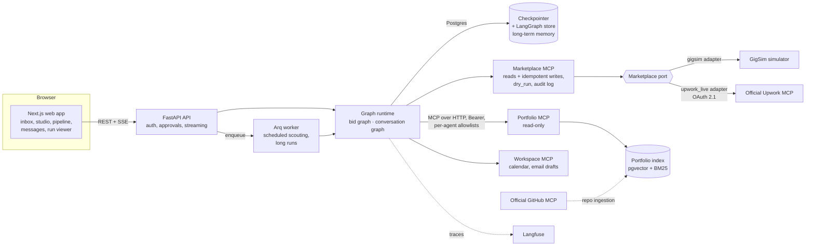
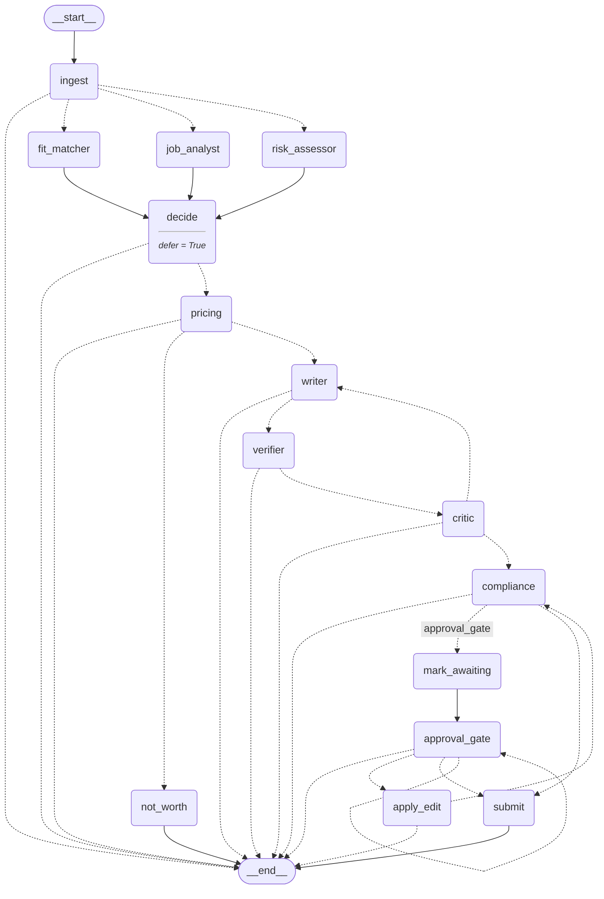
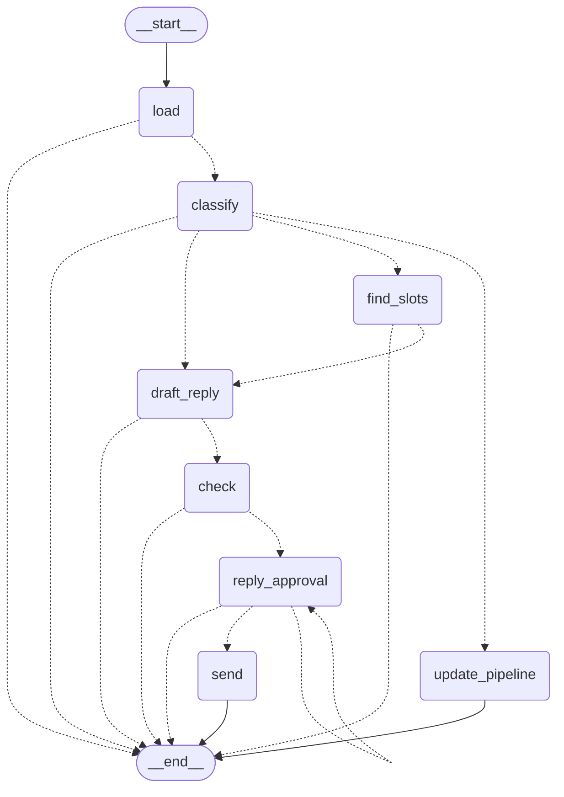

# Architecture

GigBid is a web app plus a team of LangGraph agents. The agents find freelance jobs, judge them,
write proposals grounded in portfolio evidence, and handle client conversations. A human approves
every proposal, message and Connects spend.

## Bid graph (one thread per job), rendered from code (`make graphs`)

- **Parallel analysis.** `ingest` fans out with `Send` to `job_analyst`, `risk_assessor` and
  `fit_matcher`. `decide` is a deferred node, so it waits for all three.
- **Bounded critique.** The Critic can send a draft back to the Writer **at most twice**
  (`budgets.max_revisions`). After that, its comments travel with the draft to the human.
- **Compliance.** The Compliance Guard removes contact details, guarantees and unpaid-work offers.
  It **blocks** the draft (thread status `blocked`, reason shown in the UI) when the text would move
  the deal off-platform.
- **Human approval.** `approval_gate` calls `interrupt()` with the draft, the evidence behind every
  claim, the risk report, the price rationale and the `dry_run` preview.
  - **Approve** goes to `submit`.
  - **Edit** goes to `apply_edit`, then `compliance`, then submit if Compliance changed nothing;
    otherwise back to the gate.
  - **Reject** records the reason.
- **Failure states.** Step and token budgets move a thread to `needs_attention`. A marketplace
  outage moves it to `queued_degraded`. Node failures after retries go to `dead_letter`.

## Conversation graph (one thread per client conversation)

## The marketplace port (R1)

`agent/marketplace_port.py` defines one interface. `make_port(mode)` returns either the **GigSim
adapter** (REST: rate-limit aware, circuit breaker, idempotent retries) or the **live Upwork
adapter**. The live adapter uses the official MCP server with OAuth 2.1 and encrypted per-user
tokens, and creates drafts only.

Only the Marketplace MCP server uses the port, and agents only see MCP tools. So the graph can't
tell which marketplace it's talking to. Switching between them is `marketplace.mode` in config, or
the per-user setting.

## MCP surface (Part A)

See [TOOLS.md](TOOLS.md) for every tool with its annotations and auth.

- **Portfolio (read-only):** 3 tools, 5 resource templates, 4 prompts.
- **Marketplace:** 10 read tools and 3 write tools. Writes need an idempotency key, support
  `dry_run`, require `approved_by`, are rate-limited per user, and are recorded in a hash-chained
  audit log.
- **Workspace:** free calendar slots, tentative holds, email drafts.
- **Third-party:** the official Upwork MCP server and the official GitHub MCP server.

## State, execution trace and long-term memory are kept apart (C2)

| | What | Where | Written by |
|---|---|---|---|
| **State** | What this job or conversation needs right now: job, analyses, evidence, decision, price, drafts, critiques, approvals, outcome, budgets | `agent/state.py` (`BidState`, `ConvState`, with reducers for parallel writes), persisted per super-step by the Postgres checkpointer | graph nodes |
| **Execution trace** | Every tool name, its arguments, result preview, latency and errors, plus node start/end events | `tool_events` and `run_events` tables, Langfuse spans, MCP audit logs (same trace id) | `ToolBox` / runtime |
| **Long-term memory** | Only promoted knowledge: **style rules** learned from edits, and **outcome insights** per category | LangGraph store namespaces `("memory", user, "style" \| "outcome")` | only `agent/memory/store.promote()`, through `promotion_rules.py` |

Raw edits and outcomes are first logged as events (`("events", user, ...)`). They become memory
only when a rule fires:
- **style:** the same pattern appears in at least 3 of the last 10 edits;
- **outcome:** at least 5 outcomes in a category, with a lift of at least 10 points.

Users can view and delete memories in Settings. A deletion leaves a tombstone, so the pattern
can't be promoted straight back.

## Why each agent exists

| Agent | Why it exists (and why it isn't merged) | Model tier | Tools |
|---|---|---|---|
| Scout | Scheduled and de-duplicated discovery. It's not an LLM; deterministic code is cheaper and safer. | none | search_jobs, get_job, list_events |
| Job Analyst | Turns messy posts into a typed `JobSpec`. Requirements drive retrieval and the Writer. | small | none |
| Risk Assessor | Scam and injection checks must run on every job. Rules set a floor the LLM can't explain away. | small + Prompt Guard | get_job, get_client_history |
| Fit Matcher | Maps each requirement to proof (retrieval + cross-encoder). This is the main bid/skip signal. | none (retrieval) | search_evidence, get_case_study |
| Pricing Strategist | Deterministic: market stats + client spend + user floor + Connects expected value. Easy to audit. | none | get_market_stats, get_connects_balance |
| Proposal Writer | The only place large-model quality pays off. It cites `[evidence_id]`. | large | search_evidence, get_case_study |
| Claim verifier | Separates drafting from fact-checking. Unsupported claims are removed **before** the Critic sees the draft. | small (batched) | search_evidence |
| Critic | Checks grounding, personalisation, length and screening answers. Bounded loop. | large | search_evidence |
| Compliance Guard | Policy enforcement with rules first, so a policy change is a config edit. Can block. | small + rules | none |
| Client Liaison | Conversation intent, replies, interview slots. A separate graph per conversation. | large (+ small intent) | messages, calendar, email drafts |

The R&D comparison (single ReAct agent vs prebuilt supervisor vs this graph) is in the report and
in `evals/results/multiagent_compare_*.json`.
